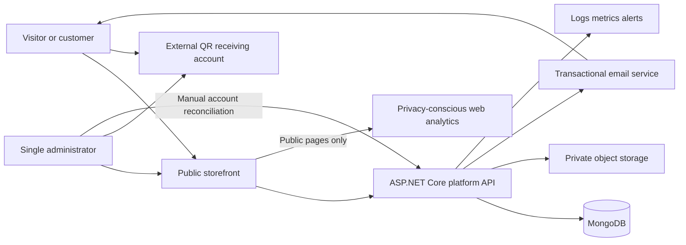
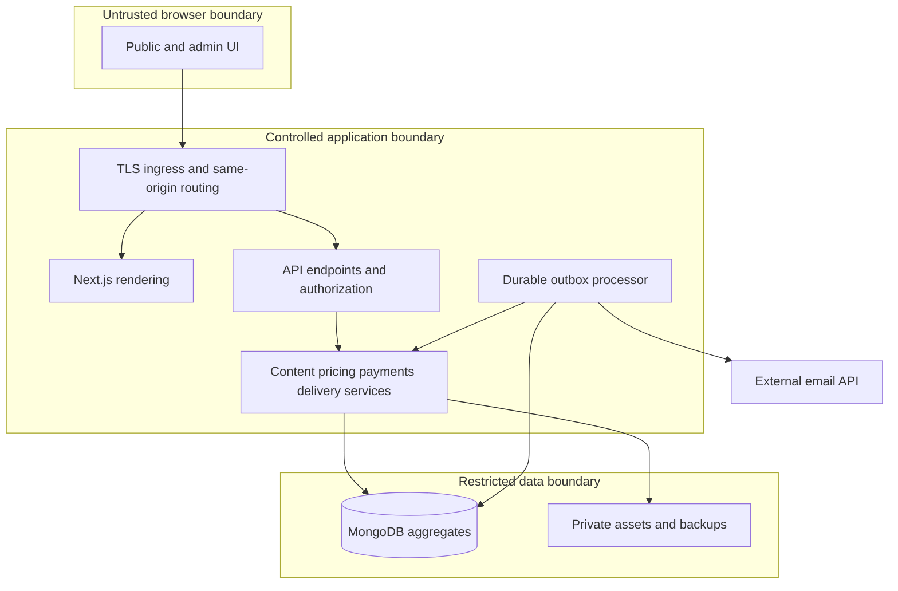
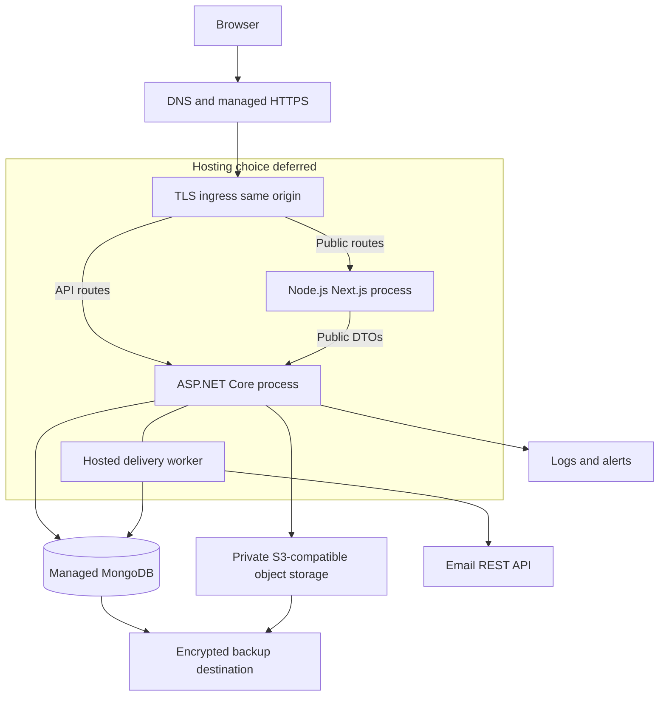

# Architecture and Technical Stack

> Part of the [Technical Design Document](./technical-design-document.md). Stable requirement, feature, rule, phase, QA, and source identifiers are shared across this documentation set.

Technology choices, architecture decisions, context/component/deployment diagrams, backend boundaries, and deployment/rollback specification. Detailed frontend, data, API, and workflow contracts are in [designs](./designs.md). Original section numbers are retained for continuity.

## 2. Technical stack

### 2.1 Recommended logical stack

| Component | Recommendation and responsibility | Alternative / trade-off |
|---|---|---|
| WEB | Next.js App Router, TypeScript strict mode, React, Tailwind CSS; public/server-rendered previews and admin UI | Plain React loses useful built-in rendering/SEO; no need for global state library initially |
| API | ASP.NET Core 10 LTS Web API, current security patches; validation, pricing, auth, orders, download grants | .NET 8/9 approach end of support in November 2026 per [S-01](./references.md#s-01); avoid a new baseline on them |
| DB | MongoDB with official .NET driver; Atlas Free candidate for pilot | Cosmos DB for NoSQL offers larger free allowance but RU/partition costs and different API semantics |
| STORE | Private S3-compatible buckets; R2 recommended candidate, separate public preview bucket | S3 is mature; region-specific egress and current free-account terms require separate costing |
| WORK | ASP.NET hosted worker in API process, durable embedded outbox; optional same-code worker deployment later | Dedicated queue/worker adds cost and operations; only justified by scale or host execution constraints |
| MAIL | Transactional REST API, Resend candidate; provider adapter with verified webhook handling | Brevo has higher free daily allowance but branding and different retry/idempotency semantics |
| OBS | Structured .NET logs, OpenTelemetry-compatible metrics, health endpoints, host alerts; Cloudflare Web Analytics for public pages | Plausible CE needs extra compute/database/maintenance; paid error-tracker can be added after budget selection |
| Authentication | One provisioned admin, ASP.NET password hasher, vetted TOTP implementation, opaque server sessions | Managed OIDC can replace credentials later; introduces provider eligibility/cost dependency |
| DNS/TLS | Selected host TLS and DNS; owned sending domain needed for recommended email service | Free host subdomain may serve pilot web UI, not substitute for a verified sending domain |
| Delivery automation | Git-based build/lint, secret/dependency checks, manual approval to production, immutable artifacts | No required automated unit/integration tests in initial scope |

Pin a stable supported Next.js/Node.js release and exact dependencies at implementation kickoff after compatibility/security checks; do not treat an unverified version number as a permanent requirement. .NET 10 support was verified in [S-01](./references.md#s-01). No dependency manifests are created by this TDD.

### 2.2 Architecture decision records

| ID | Decision / status | Rationale and consequences |
|---|---|---|
| ADR-01 | Modular monolith, accepted design recommendation | One API owns commerce; no microservices, broker, or distributed saga required |
| ADR-02 | MongoDB, recommended logical database | Natural product/order snapshots; unique indexes and atomic document writes [S-02](./references.md#s-02); no transaction feature assumption |
| ADR-03 | Embed receipt, entitlement, audit events, and outbox in order | Payment confirmation plus durable delivery intent is one atomic update; projections are reconstructible |
| ADR-04 | Email bearer access, recommended | No customer accounts; email possession is the security boundary, not strong personal identity |
| ADR-05 | Split free access from donation, confirmed | Donation failure/rejection never revokes independent free fulfillment |
| ADR-06 | Hosting topology/provider deferred | Same-origin routing and worker durability are required whichever deployment is chosen |
| ADR-07 | No public evidence upload, proposed default | Manual bank reference verification suffices if receiving provider exposes reliable identifiers; revisit only if necessary |
| ADR-08 | No automated unit/integration tests initially, confirmed | Retain build/lint, review, manual critical-path QA and explicit regression risk |

### 2.3 Candidate provider comparison

See [costs and providers](./costs-and-providers.md) for verified allowances, cost model, Nepal eligibility, and adoption gates. This is not an instruction to open accounts.

- **Hosting:** portable Node.js/.NET containers are the compatibility baseline [S-03, S-04]. Compare Render Docker, Azure Container Apps, and static Next.js export on Pages. Full Next.js server functionality is not automatically available on static Pages [S-05](./references.md#s-05). Workers' 10ms free CPU allowance is not proof that the chosen SSR stack fits [S-06](./references.md#s-06). Vercel Hobby is excluded for this commercial storefront [S-07](./references.md#s-07).
- **Database:** prefer MongoDB over Cosmos for this small catalog's developer simplicity and portable driver. Cosmos's 1,000 RU/s and 25 GB allowance is real but not serverless; usage outside allowances is billed [S-08](./references.md#s-08). Cosmos transactional batches apply only within a logical partition [S-09](./references.md#s-09); switching is a redesign, not a connection-string change.
- **Storage:** prefer R2 Standard's S3 interface, private buckets, presigned GET/PUT, and no internet egress fee [S-10, S-11]. AWS S3 remains a migration option [S-12](./references.md#s-12). Do not assume historical AWS free-tier offers apply to a new account.
- **Email:** recommend Resend REST with idempotency keys [S-13, S-14]. Brevo is a credible alternative at 300 free sends/day [S-15](./references.md#s-15). Neither service's global website proves Nepal owner onboarding or local inbox placement.
- **Analytics:** Cloudflare Web Analytics covers public page performance/traffic [S-16](./references.md#s-16); store minimal first-party funnel counters and derive finance from orders. Do not assume the web beacon supports arbitrary business-event tracking. Plausible CE is free software, not free hosted infrastructure [S-17](./references.md#s-17).

### 2.4 Portability and exit paths

Keep business logic outside provider SDK calls. Use a small storage and email boundary, not a universal cloud abstraction. Export MongoDB BSON plus index definitions/schema versions; immutable objects plus SHA-256 manifest; order receipt CSV for reconciliation; DNS and template configuration in documented non-secret configuration. R2-to-S3 migration uses the S3-compatible interface, but verify metadata, CORS, signing, and checksum differences. Email migration requires domain revalidation and webhook/idempotency reconciliation. Host migration must retain encryption/signing keys and invalidate exposed credentials; sessions may be deliberately invalidated.

## 4. Architecture

### 4.1 System context

The payment account has **no webhook/confirmation authority** in MVP. The administrator checks it separately. Email and storage responses are untrusted external input until validated.

### 4.2 Components and trust boundaries

| ID | Owns | Does not own |
|---|---|---|
| WEB | Routes, forms, public SEO/rendering, accessible admin interface | Price truth, payment approval, storage credentials |
| API | Validation, auth, lifecycle transitions, grants, upload completion, audit | Claiming that screenshot/reference alone proves funds |
| DB | Products, account snapshots, order aggregate, sessions, settings, audit and counters | File binaries |
| STORE | Quarantined/private immutable files, public sanitized covers, encrypted backups | Purchase authorization |
| WORK | Atomic job leasing, retries, webhook reconciliation, overdue-state maintenance | Independent financial approval |
| MAIL | Email transport; signed webhook events | Guaranteed inbox receipt or entitlement |
| OBS | Redacted logs, metrics, public analytics, alert evidence | Customer secrets, finance source of truth |

Trust boundaries: every browser input is hostile; admin UI visibility is not authorization. Next.js fetches public DTOs only; authenticated commerce/status/download responses must never enter shared caches. Only API/worker service credentials access private storage/database. Separate storage credentials for backup writes, object fulfillment, and admin upload where supported. Email links grant access to a particular order, not administrative power.

### 4.3 Deployment architecture: requirements, not selected providers

Deploy WEB and API as separate processes/containers behind one public origin, either on one small host or separate managed services with ingress routing. Do not create an application-written generic proxy to arbitrary destinations. Configure `/api/*` forwarding with fixed upstream, header/cookie forwarding, request limits, and trusted-proxy settings.

If static export is chosen later, it is an explicit ADR change: catalog rebuild/invalidation, dynamic product routes, same-origin API routing, cookie/CSRF behavior, and SEO freshness must be re-specified. Two always-running Render free services would share the 750-hour allowance; do not assume 750 hours for each.

Worker execution requires a live process. On sleep-to-zero services, jobs resume on activation, but an idle process cannot guarantee prompt retry. An external authenticated scheduler/managed job or always-on capacity is a **deployment adoption decision**, not an assumed free capability. No artificial keepalive loop is prescribed to evade provider terms.

### 4.5 Backend structure and consistency

Logical project structure (not files to generate now):

- `Web`: endpoints/controllers, auth policies, request validation, Problem Details, rate limits, DTOs and OpenAPI.
- `Features/Content`, `Features/Orders`, `Features/Payments`, `Features/Delivery`, `Features/Admin`: small business services and models.
- `Infrastructure`: Mongo repositories, object/email clients, clock, encryption, worker.
- One application project is sufficient initially; separate projects only if they materially improve boundaries. No generic repository framework, CQRS bus, or mandatory mediator.

Use a long-lived Mongo client with bounded connection pool (proposed maximum 20 per process; monitor total), indexes deployed explicitly, request cancellation, timeouts, and UTC dates. No database call accepts arbitrary client filters/field names. Validate DTO length/enums and reject unsupported fields on security-sensitive commands.

**Atomic order aggregate:** the authoritative order contains current payment decision, immutable receipt when confirmed, entitlement, delivery generation/jobs, and order financial/access audit events. Approval uses a filter on `_id`, current `revision`, submitted payment state, unreconciled refund state, and account/reference. One update writes the confirmed payment, receipt, entitlement (product orders only), and initial outbox job. A crash cannot leave a confirmed receipt with no durable send intent. Receipt and donation reports are projections from this aggregate, not separately committed financial truth.

Global duplicate-reference uniqueness uses a partial unique compound index on `payment.accountId` and `payment.referenceHash` when the hash exists. A reference stays reserved after rejection until admin resolves an erroneous claim. An attacker may preclaim a known reference; it causes review, never automatic delivery. Reassignment needs an explicit audited admin release of an unconfirmed claim, then submission to the rightful order. Never release a confirmed receipt's reference.

Use `revision` compare-and-set for editing/approval/refund/reissue. Unique request keys protect order creation. Different payload with same key yields 409; expired response-replay storage does not expire the unique order key. Every financial response is persisted or reconstructible before success is returned. Use bounded embedded arrays (10 payment submission attempts, 20 delivery generations, 100 job attempts and 100 order audit events); overflow returns an actionable support/review error and alerts the admin, not silent history truncation. Archive/export history under controlled maintenance before raising limits. These caps are proposed operational defaults.

### 4.12 Environment, deployment, and rollback specification

- Development uses local isolated DB/storage adapters or dedicated service namespaces; never production customer data. Staging uses separate database/buckets/keys and controlled recipient allowlist. Production requires separate account roles, HTTPS, backed-up keys and no debug errors.
- Configuration names: database URI/name, storage endpoint/bucket/public preview origin, email API key/webhook secret/from address, public origin, admin session/token-encryption keys, rate/quota limits, QR settings reference. No secret in `NEXT_PUBLIC_*`, repository, browser bundle, screenshot, or logs.
- Bootstrap owner offline with MFA/recovery codes; no public registration/bootstrap URL. Keep encryption keys versioned in selected host secret store, with encrypted offline recovery copy. Ephemeral host disks cannot hold the only data-protection key ring.
- Use additive `schemaVersion` evolution and idempotent index/data migration scripts. Back up first, deploy compatible readers, migrate, then remove old fields only after rollback window. Index creation failure aborts release; do not silently run without duplicate guards.
- CI builds/lints WEB/API, scans secrets/dependencies, publishes immutable artifacts. Admin approves deployment after staging manual cases. Maintain last known-good image/config and DB compatibility notes.
- Rollback: stop new checkouts if integrity is uncertain, preserve outbox/order data, redeploy prior compatible image, verify health/admin/public and existing grant/worker behavior, reconcile pending external sends before resuming. Database restore is a separate incident action, not routine code rollback.
- Liveness reports process only; readiness checks DB with timeout and configuration. Storage/email outages use specific alerts and UI status; readiness must not repeatedly send emails or scan buckets.
