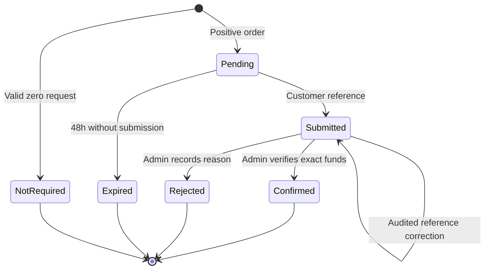
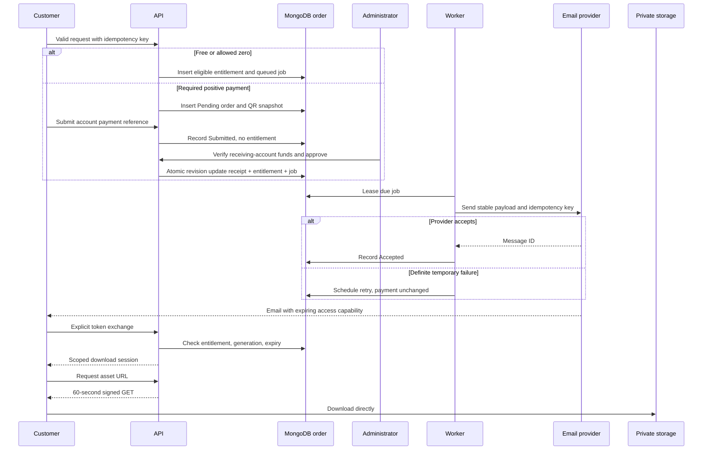

# Detailed Technical Designs

> Part of the [Technical Design Document](./technical-design-document.md). Stable requirement, feature, rule, phase, QA, and source identifiers are shared across this documentation set.

Frontend routes/rendering, data models, REST API contracts, payment/delivery state diagrams, storage, and email reliability. System boundaries and deployment decisions are in [architecture](./architecture.md). Original subsection numbers are retained for continuity.

### 4.4 Frontend routes, rendering, and caching

| Routes | Rendering / data | Security and UX |
|---|---|---|
| `/`, `/products`, `/categories/{slug}`, `/products/{slug}` | Server-rendered public DTOs; cache at most 60s, invalidate after publication changes | Only sanitized descriptions, preview images, pricing and availability; canonical metadata |
| `/search?q=&category=&mode=&cursor=` | Server rendered, bounded indexed search | No arbitrary regex; empty and failed results distinguished; search pages noindex |
| `/checkout/{productId}` | Dynamic client form backed by current API quote | Display fixed base, voluntary top-up, total, NPR, and verification delay |
| `/requests/{orderId}` | Dynamic no-store; secret in Authorization header from session memory | QR/ref/status; no email/token in URL; lost secret recovers through email/admin support |
| `/access` | No-store landing page; token supplied in URL fragment, immediately removed using history replacement | No analytics/third-party scripts; explicit user action exchanges token; email scanners' GET never consumes it |
| `/support`, `/privacy`, `/terms`, `/refund-policy` | Public documents | Explain manual verification, optional contributions, link expiry, ownership/license and support |
| `/admin/login`, `/admin/*` | Dynamic no-store | Server auth for API; session expiry and stale-edit messages; disallow indexing |
| `/support-platform` | Hidden unless donations enabled | Separate positive donation order; never routes to product entitlement |

Server components render public content; client components handle interactive amounts, form validation, secret exchange and status polling. Client validation improves UX only. Use short bounded polling with backoff, stop on terminal state/tab background; refresh does not submit again. Keep filters in URLs but secrets only in headers/memory/session-scoped storage where needed. XSS can steal browser-accessible capabilities: sanitization/CSP are essential; prefer memory and explicitly explain loss on tab close.

Unpublish invalidates cached pages immediately where supported; fallback cache TTL is <=60s. Checkout and file issuance always read current authoritative state, so stale public cache cannot authorize new fulfillment. Changing published slugs creates a stored public redirect from old to new slug; never reuse an old slug for another product.

For checkout, the authoritative product/price read is the admission boundary: a request admitted before an unpublish may finish with its snapshot; requests evaluated after that transition are rejected. Idempotency replay of an admitted request is not a new purchase. Do not promise cancellation of every in-flight request when unpublishing. Emergency asset revocation is checked separately at URL issuance and blocks even earlier orders.

### 4.6 Data model

MongoDB BSON; API IDs are opaque UUID strings, timestamps ISO 8601 UTC. Monetary fields are BSON Int64 paisa and JSON integers within safe JavaScript range; no binary floating arithmetic. All documents have `id`, `schemaVersion`, `createdAt`, `updatedAt` (required), and mutable aggregates have `revision:Int64`. Audited mutable aggregates also carry bounded `auditIntents` with event ID, actor, time and change summary for durable projection; security-critical writes commit this intent atomically. `?` means optional; all other listed fields are required unless qualified. Secrets are hashed or encrypted as specified, never plaintext in public DTOs.

| Collection / embedded type | Fields and types | Relationships, validation, lifecycle, indexes |
|---|---|---|
| `products` | `title:string(1..160)`, `slug:string(1..120)`, `descriptionHtml:string(max 50KB sanitized)`, `summary:string(max 500)`, `state:Draft/Published/Unpublished/Archived`, `categoryIds:UUID[]`, `tags:string[]`, `coverAssetId?:UUID`, `assetIds:UUID[]`, `pricing:PricingPolicy`, `license:{version:Int32,text:string}`, `seo:{title?,description?}`, `redirectSlugs:string[]`, `publishedAt?:date` | Unique slug and reserved redirect registry; indexes `(state,publishedAt,id)`, categories/state, one weighted text index title/summary/tags. Publish requires validated asset(s), owner-approved license and valid price. Retain if referenced |
| `PricingPolicy` | `mode:Free/Fixed/PWYW/Suggested/OptionalDonation/FixedPlusDonation`, `fixedPaisa?:Int64`, `minimumPaisa?:Int64`, `suggestedPaisa?:Int64`, `allowZero:bool`, `contributionEnabled:bool`, `currency:"NPR"`, `version:Int32` | Embedded; contributionEnabled applies to independent product-linked contributions for Free/OptionalDonation only. Other voluntary top-ups use FixedPlusDonation. Maximum comes from settings snapshot and A-06; valid combinations in [Rules 6.2](./rules.md#62-pricing-access-and-donation-matrix) |
| `categories` | `name:string(1..80)`, `slug:string(1..100)` | Unique slug; referenced by products; deletion needs reassignment. Tags are normalized embedded strings, max 10/product, 40 chars each |
| `slugReservations` | `slug:string`, `productId:UUID`, `kind:Current/Redirect` | Unique slug; reserve new slug before product update, retry/reconcile safely; stale reservation is not automatically reused |
| `assets` | `productId?:UUID`, `kind:Download/Cover`, `storageKey:string`, `originalName:string`, `mediaType:string`, `sizeBytes:Int64`, `sha256:string`, `status:Quarantined/Validated/Attached/Retained/Revoked`, `scan:{method,result,checkedAt,actorId}`, `storageVersion?:string` | Unique key; index product/status; downloadable keys private. Required scan fields only after validation; orphan quarantine removed after 24h, subject to worker availability |
| `orders` | `kind:Product/SupportDonation`, `productSnapshot?:{id,title,pricing,assetIds,licenseVersion}`, `relatedProductId?:UUID`, `emailCiphertext:string`, `emailLookupHmac:string`, `accessSecretHash:string`, `requestKey:string`, `requestHash:string`, `replayCiphertext?:string`, `replayExpiresAt?:date`, `amount:{requiredPaisa,contributionPaisa,totalPaisa,currency}`, `payment:Payment`, `entitlement:Entitlement`, `delivery:Delivery`, `receipt?:Receipt`, `adjustments:Adjustment[]`, `audit:OrderAudit[]`, `expiresAt?:date` | Unique requestKey, partial unique account/referenceHash, indexes payment.state/createdAt, delivery jobs' nextAttemptAt/state, emailLookupHmac/createdAt. Product snapshot required only for Product; relatedProductId is attribution only for contributions. Financial state never hard-deleted automatically |
| `Payment` | `state:NotRequired/Pending/Submitted/Confirmed/Rejected/Expired`, `accountId?:UUID`, `qrSnapshot?:{assetId,instructions,displayName,settingsVersion}`, `referenceCiphertext?:string`, `referenceHash?:string`, `submittedAt?:date`, `observedPaisa?:Int64`, `verifiedAt?:date`, `verifiedBy?:UUID`, `reason?:string`, `submissionAttempts:Submission[]` | Embedded in order; positive orders require account/QR snapshot; confirmations require actor/time/account reference and exact observed amount; submission history bounded |
| `Submission` | `id:UUID`, `referenceHash:string`, `referenceCiphertext:string`, `submittedAt:date`, `requestKey:string` | Embedded; correction before confirmation uses explicit new submission, retaining prior audit; accepted reference binding follows latest valid submission |
| `Receipt` | `id:UUID`, `accountId:UUID`, `referenceHash:string`, `observedPaisa:Int64`, `requiredPaisa:Int64`, `contributionPaisa:Int64`, `currency:"NPR"`, `verifiedAt:date`, `verifiedBy:UUID` | Immutable embedded financial fact; exactly one/order, only on positive Confirmed payment; not a claim of legally compliant tax invoice |
| `Entitlement` | `state:None/Eligible/Revoked`, `assetIds:UUID[]`, `grantedAt?:date`, `revokedAt?:date`, `reason?:string` | Embedded; product zero order becomes Eligible on acceptance, positive only on confirmation; support donation always None |
| `Delivery` | `generation:Int32`, `state:NotEligible/Queued/Sending/Accepted/Delivered/Failed/Bounced`, `jobs:DeliveryJob[]`, `grant?:{tokenHash,ciphertext,expiresAt,revokedAt?}`, `lastProviderMessageId?:string` | Embedded; token ciphertext needed to render retries, encrypted with versioned key; new generation revokes old grant; donation jobs contain receipt only and no grant |
| `DeliveryJob` | `id:UUID`, `generation:Int32`, `template:AccessAndReceipt/AccessOnly/DonationReceipt/PaymentRejected`, `recipientVersion:Int32`, `state:Queued/Leased/Accepted/Failed/Bounced/Delivered`, `attempts:Int32`, `nextAttemptAt:date`, `leaseUntil?:date`, `leaseOwner?:string`, `providerKey:string`, `providerMessageId?:string`, `lastErrorCode?:string`, `events:JobEvent[]` | Embedded outbox; rejected-payment notification can exist while primary access delivery is NotEligible; stable job key/payload for retries, bounded attempt history |
| `JobEvent` | `id:UUID`, `at:date`, `kind:Attempt/Accepted/Delivered/Bounced/Failed`, `providerEventId?:string`, `errorCode?:string` | Embedded; providerEventId used for webhook deduplication within the job; no payload bodies, recipient email, tokens or signed URLs |
| `Adjustment` / `OrderAudit` | Adjustment: `id,kind:DisputeOpened/DisputeResolved/Refund,amountPaisa?,externalReference?,reason,actorId,at`; Audit: `id,action,actorId?,at,fromRevision,toRevision,reason?,jobId?` | Embedded atomic records; refund total <= verified amount; required reason. Never erase original receipt |
| `admins` | `login:string`, `passwordHash:string`, `totpSecretCiphertext:string`, `recoveryCodeHashes:string[]`, `disabled:bool`, `lastLoginAt?:date` | Unique login; exactly one enabled owner, no public registration; offline bootstrap/recovery procedure |
| `sessions` | `tokenHash:string`, `adminId?:UUID`, `orderId?:UUID`, `scope:Admin/Download`, `expiresAt:date`, `lastActivityAt:date`, `csrfHash?:string`, `grantGeneration?:Int32` | Unique hash; TTL expiresAt for cleanup only; API checks expiry/revocation/idle time on every use; admin or order reference required by scope |
| `settings` | `key:string`, `value:typed document`, `version:Int32`; QR account: `accountId,displayName,qrAssetId,instructions,enabled`; limits/flags | Unique key; no raw credentials. Versioned settings changes recorded in audit; account ID changes if actual receiving account changes |
| `auditEvents` | `actorId:UUID`, `action:string`, `entityType:string`, `entityId:UUID`, `at:date`, `reason?:string`, `changeSummary:object` | Global index entity/at, actor/at; no secrets. For product/settings/admin mutation, embed audit intent on changed aggregate then project here with unique event ID; order audit remains authoritative |
| `dailyCounters` | `day:date`, `event:enum`, `productId?:UUID`, `count:Int64` | Unique day/event/product; coarse aggregate events, not visitor profiles; repair commerce counters from receipts |

Separate payment transaction and donation collections are intentionally not authoritative: `Receipt` and itemized amount fields cover them without dual-write inconsistency. No customer collection is required. Asset metadata and snapshots are immutable once sold; changes create a new asset ID.

TTL deletion is not an authorization control or an exact expiry timer. Reject expired state using server time, whether or not Mongo cleanup ran. Resolve cross-document product/settings/audit projections idempotently; financial/access correctness remains in the order.

### 4.7 REST API conventions and schemas

Base `/api/v1`; JSON UTF-8; explicit DTOs; UTC timestamps; enum strings; integer paisa; reject unsupported currency. Headers: `Idempotency-Key` UUID for creates/commands, `If-Match` revision ETag for mutations. Auth scopes:

- **Public:** no account, rate-limited.
- **Order:** `Authorization: Bearer <orderAccessSecret>`, valid for exactly that order; distinct from download token.
- **Admin:** secure opaque session cookie plus CSRF token on all unsafe methods, including login.
- **Download:** scoped HttpOnly session established from emailed capability.
- **Provider:** verified webhook signature and timestamp; never a payment approval identity.

Success returns concrete DTO or `{items:[...],nextCursor:null|string}`. Pagination uses opaque bounded cursor, default 20, max 50; stable `(createdAt,id)` ordering; approved filters only. A `quote` is advisory until order snapshot is committed; changed price/version returns 409 and requires explicit customer reconfirmation.

| Schema | Required shape |
|---|---|
| `PublicProduct` | `{id,slug,title,summary,descriptionHtml,coverUrl?,categories,tags,pricing:{mode,currency,minimumPaisa?,fixedPaisa?,suggestedPaisa?,allowZero,contributionEnabled,version},license,downloads:[{name,mediaType,sizeBytes}],available}`; never storage keys/order/email data |
| `CreateOrder` | `{productId,email,pricingVersion,chosenPaisa?,contributionPaisa?}`; Free/OptionalDonation omit amounts or use zero; fixed base read from server |
| `CreateDonation` | `{email,amountPaisa,relatedProductId?}`; strictly positive; product-linked contribution requires eligible product policy, otherwise standalone flag must be enabled |
| `OrderCreated` | `{id,accessSecret,kind,amount,paymentState,entitlementState,deliveryState,expiresAt?,paymentInstructions?}`; secret returned only on create/replay over TLS |
| `OrderStatus` | `{id,kind,productTitle?,amount,paymentState,entitlementState,deliveryState,maskedEmail,expiresAt?,reasonCode?,paymentInstructions?}`; no raw reference or grant |
| `PaymentSubmission` | `{reference:string(1..120)}` normalized by configured account rules, no screenshot; incompatible/ambiguous reference requires support |
| `VerifyPayment` | `{decision:"Approve"\|"Reject",observedPaisa?,accountId?,reference?,reason?}`; approval requires all observation fields, rejection requires reason |
| `ProductWrite` | `{title,slug,summary,descriptionHtml,categoryIds,tags,coverAssetId?,assetIds,pricing,license,seo}`; bounded fields and mode-dependent validation |
| `UploadIntent` | `{productId?,kind,fileName,mediaType,sizeBytes,sha256}`; returns `{assetId,uploadUrl,expiresAt,requiredHeaders}` |
| `DeliveryReissue` | `{reason,email?}`; changing email requires documented ownership/payment check; bumps generation and revokes old grant |
| `Refund` | `{amountPaisa,externalReference,reason}`; external funds already refunded manually; prevents duplicate external reference/command |
| `Problem` | RFC-style Problem Details `{type,title,status,code,detail,traceId,errors?}` with safe field errors; no stack traces, tokens, or raw payment references |

CreateOrder input mapping: chosenPaisa is required only for PWYW/Suggested; contributionPaisa is permitted only for FixedPlusDonation and defaults to zero. Free/OptionalDonation accept omitted amounts or explicit zeros only. Fixed accepts no customer-supplied base amount; attempts to override it are rejected, not silently trusted. Product-linked optional support uses CreateDonation instead. For SupportDonation, requiredPaisa=0, contributionPaisa=amountPaisa and totalPaisa=amountPaisa; verification is still required to record receipt of that voluntary payment, but there is no content access to gate.

Errors: 400 malformed fields; 401 missing/invalid credential; 403 insufficient scope/disabled policy; 404 unknown or inaccessible resource (same outward shape); 409 state/idempotency/reference/price conflict; 412 stale revision; 410 expired capability for an otherwise authenticated flow; 413 body/upload limit; 415 unsupported format; 422 semantically invalid amount/configuration; 429 rate limit with Retry-After; 503 required dependency unavailable, no false success. For anonymous capability probes use generic invalid-or-expired text, not customer existence disclosure.

### 4.8 Public, fulfillment, and administration contracts

All rows use the conventions above. `CommandResult` is `{id,revision,state}` with resource-specific state fields; admin mutation responses include fresh ETag. Every admin endpoint enforces server-side authorization.

| Method / path | Auth | Request / success | Validation and principal errors / rules |
|---|---|---|---|
| GET `/products` | Public | `q?,category?,tag?,mode?,cursor?,limit?` -> 200 page of PublicProduct | q <=100 chars; indexed search, publication filter; 400/429; BR-02 |
| GET `/products/{slug}` | Public | -> 200 PublicProduct or approved slug redirect | Draft/archived 404; BR-02 |
| GET `/categories` | Public | -> 200 category page | Only publicly relevant categories; no private counts |
| POST `/orders` | Public | CreateOrder + idempotency -> 201 OrderCreated; identical replay within 24h returns same 201 | Email/asset eligibility/price version; replay window expired 409 without new order; 422/429/503; BR-04..07 |
| POST `/donations` | Public | CreateDonation + idempotency -> 201 OrderCreated; same replay rules as `/orders` | Product-linked contribution requires eligible published policy; standalone disabled 403; no product entitlement; BR-06 |
| GET `/orders/{id}` | Order | -> 200 OrderStatus | Scope and hash match, no-store; 404/429; BR-07 |
| POST `/orders/{id}/payment-submissions` | Order | PaymentSubmission + idempotency -> 202 `{id,paymentState:"Submitted",revision}` | Pending or correction of Submitted only; expiry/duplicate conflict 409; BR-08 |
| POST `/access/exchanges` | Public capability | `{token}` -> 200 `{orderId,assets:[{id,name,sizeBytes}],sessionExpiresAt}` + download cookie | Valid grant, eligible order, not revoked; generic invalid/expired 404/410; BR-10/11 |
| POST `/orders/{id}/download-urls` | Download + CSRF/origin | `{assetId}` -> 200 `{url,expiresAt}` | Recheck entitlement/current generation/grant expiry/asset status; scoped presigned URL only; 403/404/410/429 |
| GET `/auth/csrf` | Public | -> 200 `{csrfToken}` bound to short pre-auth/session cookie | Same-origin, no-store, rate-limited |
| POST `/admin/sessions` | Pre-auth cookie + CSRF | `{login,password,totpOrRecoveryCode}` -> 200 `{expiresAt}` + admin cookie | Generic 401; throttled failures; MFA always required |
| DELETE `/admin/sessions/current` | Admin | -> 204 | Revokes server session; CSRF required |
| GET `/admin/products` | Admin | filters/state/cursor -> 200 page of admin DTOs | No public cache |
| GET `/admin/products/{id}` | Admin | -> 200 ProductWrite + state/revision, ETag | Includes quarantined attachment status, no storage credentials |
| POST `/admin/products` | Admin | ProductWrite -> 201 `{id,revision,state:"Draft"}` | BR-01; 409 slug conflict, 422 invalid pricing |
| PATCH `/admin/products/{id}` | Admin | partial ProductWrite + If-Match -> 200 CommandResult | Server sanitizes, stale 412; price version changes on pricing edit |
| POST `/admin/products/{id}/transitions` | Admin | `{to:"Published"\|"Unpublished"\|"Archived",reason?}` + If-Match -> 200 CommandResult | Publish prerequisites; archive blocks new orders; 409/422 |
| DELETE `/admin/products/{id}` | Admin | If-Match -> 204 | Only unreferenced draft; otherwise 409 and offer archive |
| POST/PATCH/DELETE `/admin/categories[/{id}]` | Admin | `{name,slug}` or delete + If-Match -> 201/200/204 | Referenced category delete 409; tag values edited through product |
| POST `/admin/assets/upload-intents` | Admin | UploadIntent -> 201 intent response | Quota/type/size check before signed private upload; 413/415/422 |
| POST `/admin/assets/{id}/completion` | Admin | `{}` -> 202 `{id,status:"Quarantined"}` | HEAD/checksum and trusted scan pending; forged metadata cannot validate |
| POST `/admin/assets/{id}/validation` | Admin | `{scanMethod,scanResult,reason}` -> 200 status | Scan evidence/manual safe workflow; only Clean may become Validated; no public attachment while quarantined |
| DELETE `/admin/assets/{id}` | Admin | If-Match -> 204 | Only unreferenced/unpublished asset; referenced/sold asset returns 409 |
| POST `/admin/assets/{id}/revocations` | Admin | `{reason}` + If-Match -> 200 CommandResult | Mark Revoked; all subsequent URL issuance denied; append audit, preserve bytes for investigation |
| GET `/admin/orders` | Admin | payment/delivery/kind/date filters -> 200 page | Search email via keyed hash, no email in query URL; sensitive search uses POST `/admin/orders/search` with `{email,...filters}` |
| GET `/admin/orders/{id}` | Admin | -> 200 order review DTO with masked/unmasked necessary details and ETag | Access to reference/email logged; never expose token ciphertext |
| POST `/admin/orders/{id}/payment-decisions` | Admin | VerifyPayment + If-Match + idempotency -> 200 CommandResult | Submitted only, exact comparison, duplicate reference; 409/412/422; BR-08 |
| POST `/admin/orders/{id}/reference-release` | Admin | `{reason}` + If-Match -> 200 CommandResult | Only unconfirmed claim, append audit; confirmed 409 |
| POST `/admin/orders/{id}/delivery-reissues` | Admin | DeliveryReissue + If-Match -> 202 `{jobId,generation}` | Eligible product or confirmed donation receipt; dispute/refund policy; 409 |
| POST `/admin/orders/{id}/delivery-retries` | Admin | `{jobId,reason}` + idempotency -> 202 job status | Same generation/payload; unknown provider outcome requires reconciliation first |
| POST `/admin/orders/{id}/adjustments` | Admin | Refund or `{kind:"DisputeOpened"\|"DisputeResolved",reason}` + If-Match -> 200 CommandResult | Confirmed orders only; refund bounds and unique reference; BR-09 |
| GET `/admin/dashboard`, `/admin/reports/transactions` | Admin | date range/cursor -> 200 aggregates/page or CSV via Accept | Inclusive start/exclusive end UTC; daily grouping Kathmandu; spreadsheet-safe CSV; BR-14 |
| GET `/admin/settings`, `/admin/audit-events` | Admin | -> 200 settings/audit page | Redacted config; cursor/date bounds |
| PUT `/admin/settings/{key}` | Admin | typed value + If-Match -> 200 CommandResult | Allowlisted key schema, audit, no credentials; disabled QR blocks new positive requests |
| POST `/webhooks/email` | Provider | signed provider event -> 204 | Verify raw-body signature/timestamp before parse; dedupe event ID; unknown message safely logged without PII |
| POST `/events` | Public | `{event:"View"\|"DownloadRequested"\|"CheckoutStarted",productId?}` -> 202 | Allowlist, rate-limit, aggregate only; no custom free-text props |
| GET `/health/live`, `/health/ready` | Restricted detail | -> 200 or 503 minimal | No secrets/DB names; readiness checks DB, not costly email sends |

No public endpoint approves payments or resends an arbitrary email. Admin support handles expired-link recovery initially, reducing enumeration/spam. Destructive commands require explicit admin confirmation in UI plus server conditions, not just a dialog.

### 4.9 Payment, entitlement, and delivery state machines

Order has no independently writable "paid/completed" flag. Its customer summary is derived: awaiting payment, awaiting review, access ready, rejected, expired, or refunded/disputed. Authoritative axes:

| Axis | States and allowed transitions |
|---|---|
| Payment | Zero: NotRequired terminal. Positive: Pending -> Submitted or Expired; Submitted -> Confirmed or Rejected. Correction may update Submitted before decision. Expired/Rejected require new order or documented support reconciliation; never automatic resurrection |
| Entitlement | Product: None -> Eligible on zero acceptance or positive confirmation; Eligible -> Revoked on full refund, dispute hold, security/content recall. Regrant only audited admin resolution; donation remains None |
| Access delivery | NotEligible -> Queued -> Sending -> Accepted -> Delivered; Sending -> Failed -> Queued for definite retry; Accepted -> Bounced; reissue creates a new generation. Provider Accepted is not Delivered |
| Capability | Active until expiresAt or revokedAt; expiry is independent of email delivery and entitlement |

Submitted orders do not auto-expire while awaiting admin review. Rate-limited overdue reminders appear on dashboard. Late funds for an expired/rejected order are handled manually: refund externally, or create a linked replacement order with current explicitly accepted terms and verify actual funds there. Never charge again merely to repair a record. Support may release an unconfirmed reference to that replacement with audit.

### 4.10 Uploads, storage, and delivery

- Separate public sanitized cover images from private deliverables; no public `r2.dev` or bucket website for private assets/backups. Private object key: environment/product UUID/asset UUID/version; never use customer email or unsanitized file name.
- Admin-only upload intent, short signed PUT to quarantine, exact expected type/checksum. Presigned PUT alone may not enforce size: completion must verify actual bytes/type/hash before eligibility; delete/revoke oversize objects and account for temporary oversize billing risk. Never trust client Content-Type.
- Proposed download allowlist: PDF, ZIP, EPUB, PNG/JPEG/WebP, MP3/WAV, MP4 as downloadable attachments. Block executable/script/HTML/SVG formats by default. ZIP content cannot be declared safe by extension; inspect/scanning with archive-depth/expansion limits and safe tooling. Publish only after malware scan/manual documented review. No public screenshot uploads. Covers max 5 MB and re-encoded.
- File scan may be an owner-operated trusted local process for a small catalog; do not claim an unbudgeted cloud scanner. Missing scan evidence blocks publication. Product file contents may be copyrighted by the owner/licensor; owner must confirm distribution rights.
- Asset upload is immutable after attachment/sale. Replacement creates new asset ID for future orders; old orders keep pinned validated assets. Normal unpublish/archive prevents new orders but honors earlier entitlements. Emergency asset revocation blocks new URL issuance for all affected orders and requires support/remediation.
- Email link carries a 256-bit random capability in fragment, not query. Store SHA-256 hash for validation; encrypted payload only to retry the same email. Landing page has no analytics, third-party embeds, or referrer leakage; immediately remove fragment and explicitly POST exchange. Do not consume on GET or count email scanner fetch as delivery.
- Exchange grants an HttpOnly Secure SameSite=Lax download cookie bound to order/generation, expiring at the earlier of 15 minutes or grant expiry. Each URL issuance checks current entitlement, grant generation, grant expiry and asset status. CSRF/origin checks on cookie-authenticated POSTs. Grant is reusable during 72h, not one-use; multiple devices are allowed subject to rate limits.
- A signed GET lasts 60 seconds, uses attachment disposition/safe filename, and permits the selected object only. It is a bearer credential and can be reused/shared until expiry. Revocation stops new URLs but cannot recall a previously issued URL before its remaining lifetime ends. An already running transfer may continue after signing expiry; do not claim byte-perfect revocation or completed-download counts.
- Status page never exposes the access grant. Reissue/email correction requires admin ownership/payment validation, audited reason, new generation and token, invalidates prior sessions by generation check, and does not create a payment.

### 4.11 Worker and email reliability

Atomically lease due job with leaseOwner/leaseUntil; proposed 2-minute lease and 30-second external request timeout. Extend lease only while actively processing. Prepare and persist token/hash/encrypted payload and expiry before the first external send, guarded by generation and revision; a lease retry must reuse those values. Recheck eligibility/generation before sending and before recording results. A concurrent refund/reissue can still leave an already in-flight email in the inbox, but its revoked grant cannot authorize new downloads. Restart resumes queued/expired-lease jobs. Do not rely on process memory, an unawaited task after HTTP response, or host local disk.

Definite temporary failures retry after approximately 1 minute, 5 minutes, 30 minutes, and 2 hours (five total attempts including initial send), within provider idempotency window. Respect Retry-After and daily/monthly quotas. Permanent recipient errors/bounces suppress automatic retries and alert owner. Provider outages/quota exhaustion leave work pending with visible error, never mark it sent or roll back funds.

Resend keys persist for 24h [S-14](./references.md#s-14). Retries within that window reuse job ID/key and exact recipient/template/token payload. A timeout after send is **unknown outcome**, not definite failure: query provider/message status or reconcile dashboard; do not blindly re-send outside the key window. Represent unresolved outcome as Failed with lastErrorCode=OUTCOME_UNKNOWN, suppress automatic retries outside the safe window, and require manual reconciliation. SMTP/other provider without idempotency cannot guarantee exactly-once emails; duplicate email remains a known residual risk, while duplicate financial confirmation is prohibited.

Issue one combined receipt/access email for a verified product purchase, access-only for zero requests, donation receipt for verified support contribution, and rejection notice for rejected submitted payments. No payment-submission email is required; browser acknowledgement reduces free-tier usage. Email acceptance is distinct from Delivered webhook. Verify webhook signature, freshness and event ID; match provider message ID/generation, handle out-of-order events without regressing Delivered to Accepted, and record bounce separately.

Link expiry is computed at first send preparation and frozen for identical retries. If it expires while delayed, explicitly reissue a new generation after resolving unknown sends. No webhook may change payment state. Disable open/click tracking on secure transactional messages.
